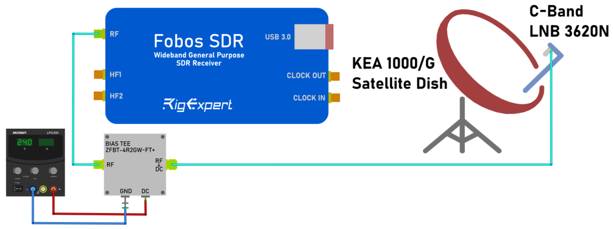
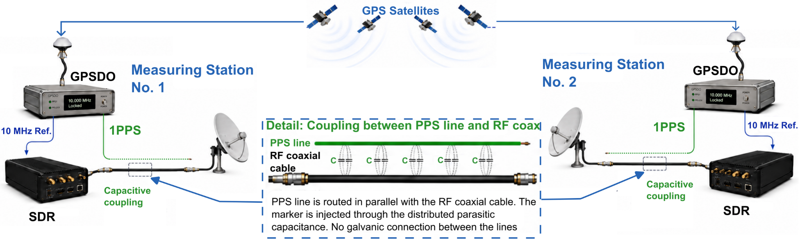
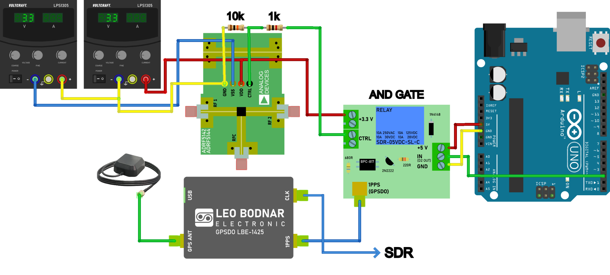
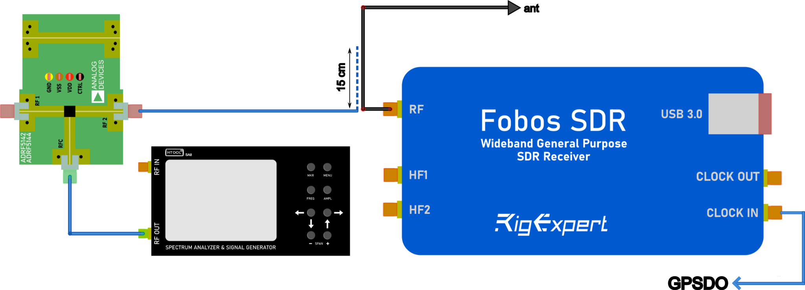
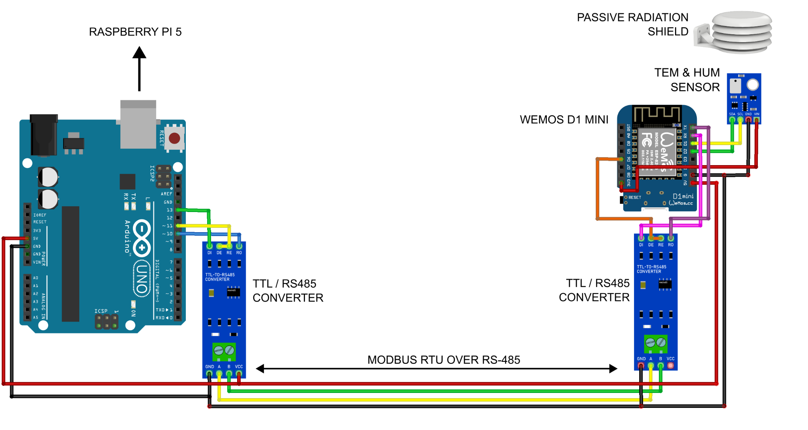

# Measurement Methodology

## 1. Experimental design

Two SDR measurement stations were deployed to compare C-band satellite downlink reception in different terrestrial radio environments:

- **Zlín:** An urban measurement site on the roof of the Faculty of Applied Informatics, Tomas Bata University in Zlín, near terrestrial transmitters.
- **Hošťálková:** A rural reference site on the roof of a shelter, with more limited mapped coverage in the 3.4–3.8 GHz band. Coverage was indicated for Vodafone only during the project team's inspection of the Czech Telecommunication Office coverage map.

Both antennas had an unobstructed view in the selected reception direction. The stations used the same principal hardware and acquisition settings, with different coaxial cable lengths.

Measurements were conducted during **18–30 September 2026** and **15–25 October 2026**. Each station recorded **60 seconds of IQ data every 10 minutes**. The combined dataset contains approximately **14.34 TB** of recordings.

## 2. Receiving equipment

| Component | Specification |
|---|---|
| Reflector | Kathrein KEA 1000/G, 100 cm diameter, aluminium reflector |
| LNB | Norsat 3620N, linear polarization, 5150 MHz local oscillator, 50 Ω output |
| LNB power injection | ZFBT-4R2GW-FT+ bias tee |
| Coaxial cable | SSB Electronic Ecoflex 10, product code 6085, 50 Ω, approximately 10.2 mm outer diameter |
| Cable length — Zlín | 17 m |
| Cable length — Hošťálková | 10 m |
| SDR receiver | FOBOS SDR |
| Acquisition computer | Raspberry Pi 5 with 16 GB RAM |
| External frequency and timing reference | Leo Bodnar LBE-1425, two-port GPSDO |

The LNB converted the received C-band signal to an intermediate frequency (IF), which was recorded by the SDR. The bias tee supplied DC power to the LNB.

*Receiving chain connecting the LNB to the SDR through the bias tee. The laboratory supply provides 24 V DC to the LNB, while the bias tee blocks this DC voltage towards the SDR.*

Hardware schematics and wiring details are provided in [`../measurement_stations/`](../measurement_stations/).

## 3. Antenna alignment

The nominal antenna settings at both sites were:

| Parameter | Setting |
|---|---|
| Azimuth | 180° |
| Elevation | 33° |
| Receive polarization | Horizontal |

These values describe the installation settings. They do not independently establish the identity of the received satellite.

## 4. Frequency plan and acquisition settings

| Parameter | Setting |
|---|---|
| IF centre frequency | 1312 MHz |
| Sampling rate | 10 MS/s |
| Nominal recorded bandwidth | 10 MHz |
| SDR LNA gain | 0 dB |
| SDR VGA gain | 0 dB |
| Sample storage type | Signed 16-bit integers (`int16`) |
| Recording file extension | `.raw` |
| Recording duration | 60 s |
| Recording interval | 10 min |

The LNB provided sufficient gain for acquisition, so both SDR gain stages were set to 0 dB.

With the LNB local oscillator at 5150 MHz, the frequency conversion is:

`RF frequency = 5150 MHz − IF frequency`

The IF centre frequency of 1312 MHz therefore corresponds to an RF centre frequency of **3838 MHz**. The nominal RF coverage is approximately **3833–3843 MHz**, with reversed frequency ordering relative to the IF spectrum.

The downlinks of interest were:

| RF centre frequency | Corresponding IF centre frequency | Approximate signal bandwidth |
|---|---|---|
| 3839 MHz | 1311 MHz | 2 MHz |
| 3842 MHz | 1308 MHz | 0.5 MHz |

The binary recording layout and associated metadata are documented in [`data_formats.md`](data_formats.md).

## 5. Timing and frequency synchronization

Synchronization used three complementary mechanisms.

### 5.1. NTP-based recording schedule

The Raspberry Pi system clocks were synchronized using NTP. Recording starts were scheduled from these clocks.

This provided coarse temporal correspondence between the stations for comparisons of SNR, broadband interference, and noise statistics over the measurement campaigns. NTP timing alone was not used to claim sample-level alignment.

### 5.2. External 10 MHz reference

Each FOBOS SDR used an external 10 MHz reference from a Leo Bodnar LBE-1425 GPSDO to improve frequency stability and reduce relative sampling-clock drift.

This frequency reference did not by itself establish a common sample start or phase coherence between the complete receiving chains.

### 5.3. Recorded PPS markers

GPSDO-derived PPS markers were injected into the recorded signal to provide precise timing references within the IQ data.

These markers supported alignment for analyses requiring finer temporal correspondence, particularly downlink frame comparisons. Subsequent fine alignment was performed using cross-correlation.

### 5.4. Dual-station synchronization concept

Both stations use GPS-disciplined references to stabilize the SDR sampling clocks and provide PPS timing for marker injection. The recorded markers support subsequent inter-station time alignment.

*Conceptual illustration of GPSDO-referenced frequency stabilization and capacitively coupled timing markers at both stations. The PPS-to-injection path is simplified: in the implemented system, PPS controls an RF switch that gates a separately generated RF carrier. The final injection arrangement is described in Section 6.*

## 6. PPS marker generation and injection

| Parameter | Setting |
|---|---|
| RF marker frequency | 1315 MHz in the recorded IF band |
| Marker pulse duration | 100 ms |
| Intended marker count | Five pulses at the beginning of each recording |
| Markers used for alignment | Four pulses |
| Arduino-controlled injection window | 5 s |
| Capacitive coupling length | Approximately 15 cm |
| RF signal generator | HTOOL SA8 |
| RF switch | ADRF5144-EVALZ |
| Arduino timing source | NEO-7M GPS module |

The HTOOL SA8 generated a continuous-wave RF signal at 1315 MHz. This frequency was selected in a region of the recorded spectrum containing noise rather than a downlink of interest.

The marker signal was gated by an ADRF5144-EVALZ RF switch and coupled capacitively into the receiving path over approximately 15 cm.

The RF switch control was produced by an AND gate combining:

- The PPS signal from the GPSDO.
- An enable signal from the Arduino.

*Connections between the GPSDO, Arduino, custom AND control assembly, and RF switch. Two laboratory supplies provide the RF switch with +3.3 V and −3.3 V relative to the common reference.*

*The RF generator supplies a continuous-wave marker signal to the RF switch. The gated output is coupled capacitively into the receiving cable over approximately 15 cm near the SDR input. A separate GPSDO output supplies the SDR with a 10 MHz frequency reference.*

Injection was enabled only when both inputs were high. The Arduino provided the five-second enable window at the beginning of each recording, while the GPSDO PPS signal defined the timing of the individual marker pulses. The Arduino obtained its time reference from a NEO-7M GPS module.

The first marker was unsuitable for alignment because its capture depended on the recording start timing. The remaining four markers were used for timing analysis.

The marker interval must be accounted for when selecting data segments for spectral or noise analysis.

## 7. Environmental monitoring

Air temperature and relative humidity were recorded to provide environmental context for the radio measurements.

An AHT10 sensor was installed near each dish inside a **TFA Dostmann 98.1114.02 radiation shield**.

The reported nominal sensor accuracies were:

| Quantity | Nominal accuracy |
|---|---|
| Relative humidity | ±2 percentage points RH |
| Temperature | ±0.3 °C |

A Wemos D1 mini read the sensor and communicated with the Arduino over an RS-485 link using Modbus. RS-485 accommodated the distance between the outdoor sensor and the equipment location.

*Environmental monitoring connections. The Wemos D1 mini reads the outdoor sensor and communicates with the Arduino over RS-485. The Arduino forwards environmental readings to the Raspberry Pi over USB.*

The Arduino forwarded environmental readings to the Raspberry Pi over USB. Environmental values were stored as metadata associated with each recording.

These measurements represent conditions near the antenna, rather than direct measurements of LNB or SDR component temperatures.

## 8. Operational monitoring

Remote access was configured on both Raspberry Pi computers. Recording continuity was checked regularly during the campaigns.

Before the main acquisition, a three-day pilot dataset was inspected. No anomalies were identified during those checks.

The stations did not use a UPS or a dedicated mechanism to compensate for power interruptions. Consequently, scheduled recordings should not be assumed to exist solely from the configured acquisition interval; actual data availability must be established from the recording catalog.

## 9. Comparability and interpretation

The stations shared the same principal equipment, nominal antenna settings, and SDR acquisition parameters. However, the coaxial cable runs differed: 17 m in Zlín and 10 m in Hošťálková.

This difference introduces unequal cable attenuation and potentially different contributions from the receiving chains. Absolute recorded levels must therefore be interpreted with these installation differences in mind. Identical component models alone do not establish calibrated equality between the stations.

The experiment compares reception under two different site conditions. Site differences and daytime–nighttime patterns provide evidence relevant to the interference hypothesis, but do not independently identify a particular transmitter as the cause.

## 10. Related documentation

- [`project_overview.md`](project_overview.md) — Objectives, scope, and main findings.
- [`station_locations.md`](station_locations.md) — Site descriptions and installation conditions.
- [`data_formats.md`](data_formats.md) — IQ file structure and metadata.
- [`analysis_workflow.md`](analysis_workflow.md) — Processing sequence and analysis methods.
- [`../measurement_stations/`](../measurement_stations/) — Hardware documentation and acquisition software.
