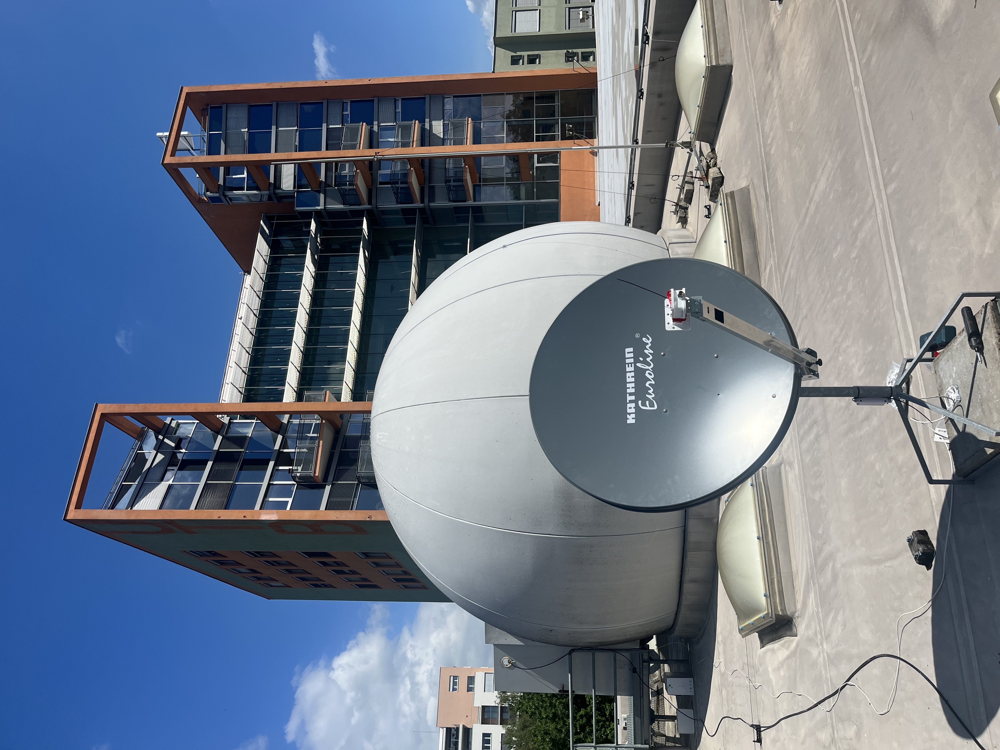
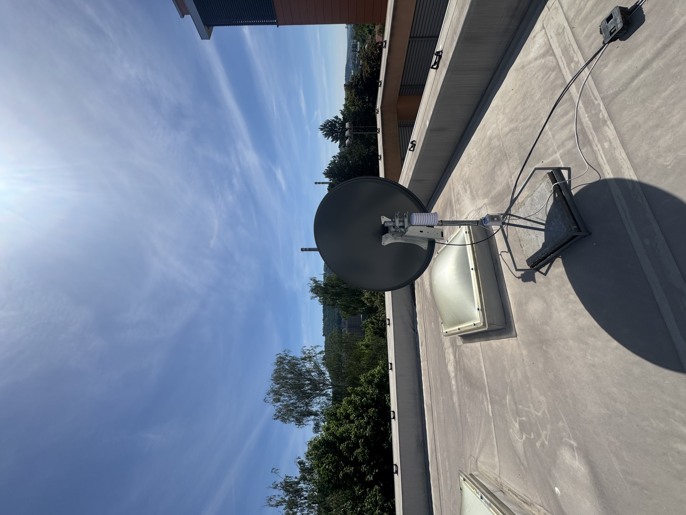
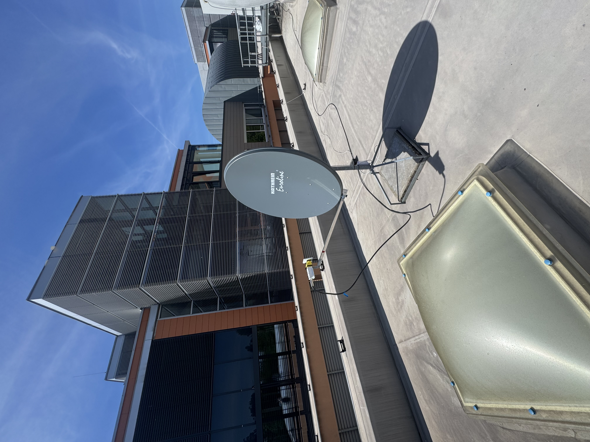
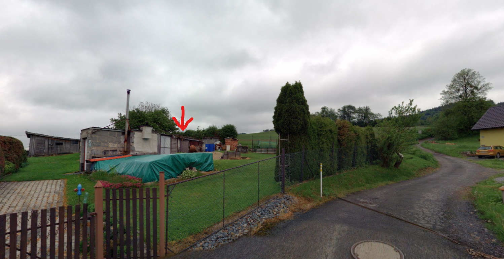
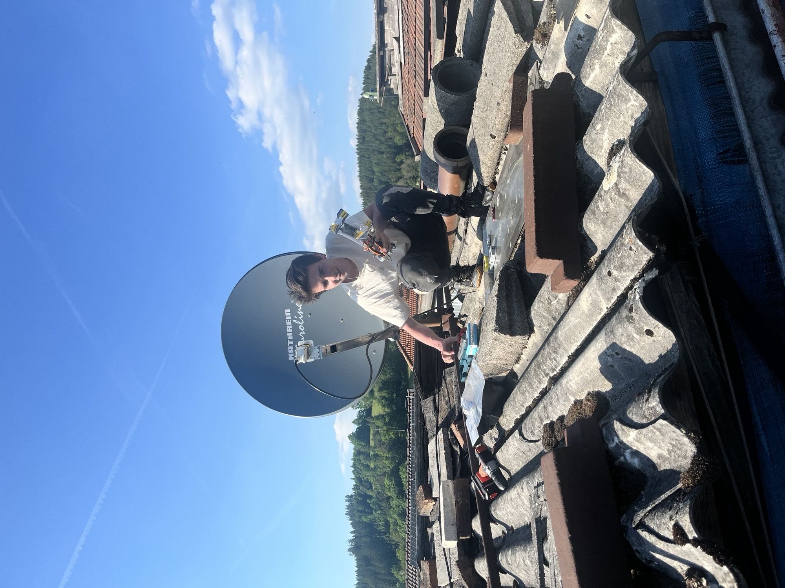
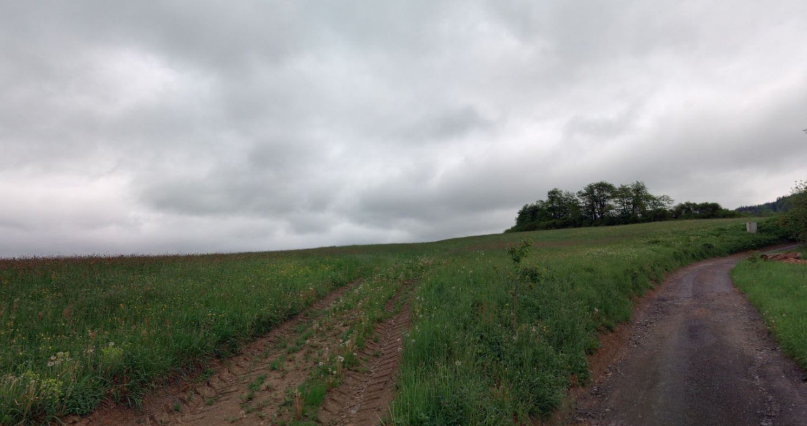

# Station Locations

## 1. Overview

Two measurement stations were deployed in the Zlín Region, Czech Republic, to compare C-band satellite downlink reception in urban and rural environments.

The urban station was located at the Faculty of Applied Informatics, Tomas Bata University in Zlín. The rural reference station was located in Hošťálková.

Both stations used the same principal receiving equipment and nominal antenna pointing settings. Their surroundings, installation conditions, and coaxial cable lengths differed.

## 2. Site coordinates and installation parameters

| Parameter | Urban station — Zlín | Rural station — Hošťálková |
|---|---|---|
| Latitude | 49°13′48.13″ N | 49°21′31.98″ N |
| Longitude | 17°39′24.43″ E | 17°53′25.46″ E |
| Latitude, decimal degrees | 49.230036 | 49.358883 |
| Longitude, decimal degrees | 17.656786 | 17.890406 |
| Reported site elevation above sea level | 244 m | 385 m |
| Installation | Faculty building roof | Shelter/outbuilding roof |
| Nominal antenna azimuth | 180° | 180° |
| Nominal antenna elevation angle | 33° | 33° |
| Receive polarization | Horizontal | Horizontal |
| Coaxial cable length | 17 m | 10 m |

The reported site elevations are not antenna heights above ground. Antenna mounting heights above ground were not provided.

## 3. Urban station — Zlín

### Installation

The urban antenna was installed on a flat roof at the Faculty of Applied Informatics, Tomas Bata University in Zlín.

The reflector was supported by a freestanding metal mounting structure with ballast. A radiation shield for the environmental sensor was mounted near the antenna.

The installation had a reported unobstructed view along the selected reception direction.

### Surrounding environment

The photographs show a university campus environment with a nearby multistorey building, roof parapets, skylights, and other rooftop structures. Trees border parts of the site, while buildings, industrial chimneys, and wooded hills are visible in the wider surroundings.

The station therefore represents an urban receiving environment containing both built structures and vegetation. Its clear view in the selected reception direction does not imply an unobstructed horizon in every direction.

Nearby buildings, rooftop structures, and terrain may influence terrestrial propagation and reflections. Their individual contributions were not isolated by the experiment.

### Mobile network coverage

During the project team's inspection of the Czech Telecommunication Office coverage map, coverage in the **3.4–3.8 GHz band** was indicated at the urban location for:

- T-Mobile
- O2
- Vodafone

This map-based assessment provided context for selecting the urban site as a location potentially exposed to terrestrial mobile transmissions.

## 4. Rural reference station — Hošťálková

### Installation

The rural antenna was installed on the roof of a shelter/outbuilding.

The installation photograph shows the reflector above nearby roof surfaces, with vegetation and wooded slopes visible in the background. The team reported an unobstructed view along the selected reception direction.

### Surrounding environment

The supplied site photographs show low-rise residential and ancillary buildings, gardens, grassed areas, hedges, and trees. Open land and wooded hills form part of the surrounding landscape.

The approximate view towards the reception direction shows an open meadow with gently rising terrain, scattered groups of trees, and a wooded slope to the right. No continuous built-up area is visible in this view. Although low-rise buildings are present around the installation, the landscape towards the selected reception direction is predominantly open.

The photograph illustrates the general surroundings rather than the exact antenna boresight or a measured horizon profile.

The site represents a rural residential environment with less dense development than the urban campus location. It is not an isolated site without buildings or potential terrestrial radio sources.

### Mobile network coverage

During the project team's inspection of the Czech Telecommunication Office coverage map, coverage in the **3.4–3.8 GHz band** was indicated for **Vodafone only** at the rural location.

The site was therefore used as a reference with more limited mapped operator coverage, rather than as a location completely free from 5G coverage or terrestrial interference.
## 5. Coverage assessment and interpretation

Mobile network coverage was assessed using the [Czech Telecommunication Office VPortal mobile coverage map](https://vportal.ctu.gov.cz/mobile/mapa), focusing on the 3.4–3.8 GHz band.

| Site | Operators with coverage indicated during the team's map inspection |
|---|---|
| Zlín | T-Mobile, O2, Vodafone |
| Hošťálková | Vodafone |

These observations describe the map information consulted by the team. They do not directly quantify the interference power reaching either satellite receiving chain.

In particular, mapped coverage and operator count do not independently establish transmitter activity, received field strength, or the contribution of a particular transmitter to reception degradation.

The rural site should consequently be described as a **reference environment with more limited mapped coverage**, rather than an interference-free baseline.

## 6. Photographic documentation

The photographs below document the antenna installations and their surroundings. Equipment and electronics photographs are available in the [hardware gallery](../measurement_stations/hardware/photos/README.md).

### Urban installation — Zlín

*Urban antenna installation on the faculty roof, with the faculty building in the background.*

*Rear view showing the antenna support, environmental monitoring equipment, and wider surroundings.*

*Side view of the reflector, LNB assembly, and rooftop installation.*

### Rural installation — Hošťálková

*Map-service imagery showing the rural installation area. The arrow marks the shelter on which the antenna was installed.*

*Rural antenna during installation, with nearby rooftops and wooded slopes in the background.*

*Map-service imagery illustrating the approximate reception direction and surrounding landscape. The viewpoint differs from the antenna position and does not represent an exact boresight or measured horizon profile.*

## 7. Comparison considerations

The experiment compares two complete receiving installations in different environments.

Relevant differences include:

- Urban campus surroundings versus rural residential surroundings.
- Different site elevations and mounting conditions.
- Different local buildings, vegetation, and terrain.
- Coaxial cable lengths of 17 m and 10 m.
- Different mapped mobile operator coverage.

These differences must be considered when interpreting absolute recorded levels and reception quality. Site comparisons and temporal variations support investigation of terrestrial interference, but do not alone isolate a specific transmitter as its cause.

## 8. Related documentation

- [`project_overview.md`](project_overview.md) — Objectives, scope, and main findings.
- [`measurement_methodology.md`](measurement_methodology.md) — Receiving equipment, acquisition, and synchronization.
- [`analysis_workflow.md`](analysis_workflow.md) — Analysis methods and processing dependencies.
