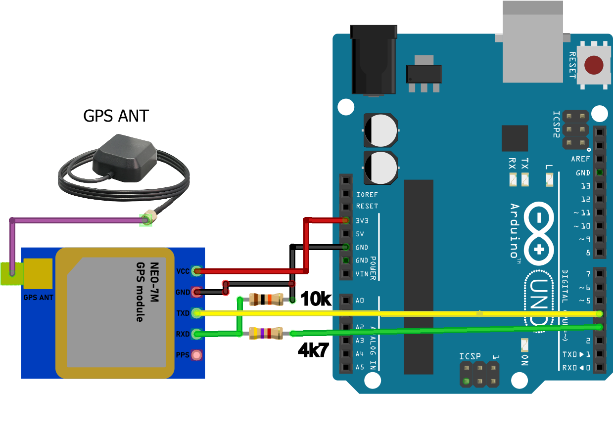
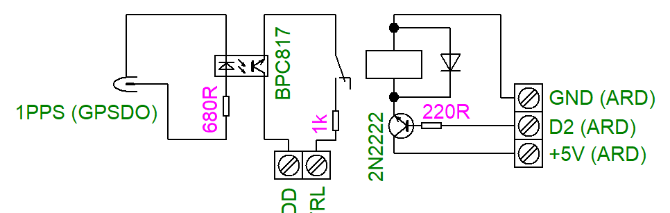

# Hardware

This directory contains the component list, electrical schematics, wiring diagrams, and installation photographs for the measurement stations.

## Component list

The complete hardware inventory and quantities for both stations are provided in [component_list.csv](component_list.csv).

## Wiring diagrams

| Diagram | Description |
|---|---|
| [Receiving chain](wiring/lnb_bias_tee_sdr_wiring.png) | LNB, bias tee, 24 V supply, and SDR connections |
| [PPS marker control](wiring/pps_marker_control_wiring.png) | GPSDO, Arduino, custom control assembly, RF switch, and bipolar power supply |
| [RF marker injection](wiring/marker_capacitive_coupling.png) | RF generator, switch, capacitive coupling, and SDR frequency reference |
| [Arduino GPS module](wiring/arduino_gps_module_wiring.png) | NEO-7M power and serial connections |
| [Environmental monitoring](wiring/environmental_monitoring_rs485_wiring.png) | Sensor, Wemos D1 mini, RS-485 converters, and Arduino connections |

## Arduino GPS connection

The NEO-7M module supplies GPS-derived time information to the Arduino. The precise PPS reference used for marker injection is provided separately by the GPSDO.

*Power and serial connections between the NEO-7M GPS module and the Arduino, including the resistor network shown in the wiring diagram.*

## PPS control circuit

The custom circuit implements an AND control function using a relay and an optocoupler. RF marker injection is enabled when both the Arduino-controlled window and the GPSDO PPS signal are active.

*Electrical schematic of the relay and optocoupler control assembly.*

## Hardware photographs

The [hardware gallery](photos/README.md) documents both antenna installations, equipment setups, enclosure construction, PPS control boards, and environmental monitoring electronics.

Descriptions of the measurement sites are provided in [Station locations](../../docs/station_locations.md).

## Related documentation

- [Measurement methodology](../../docs/measurement_methodology.md)
- [Measurement station overview](../README.md)
