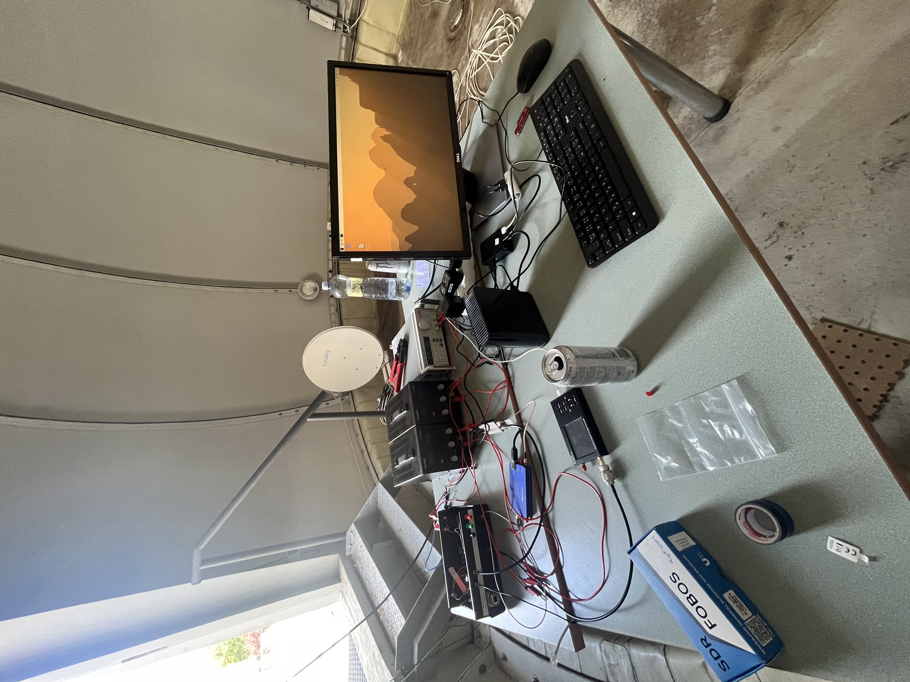
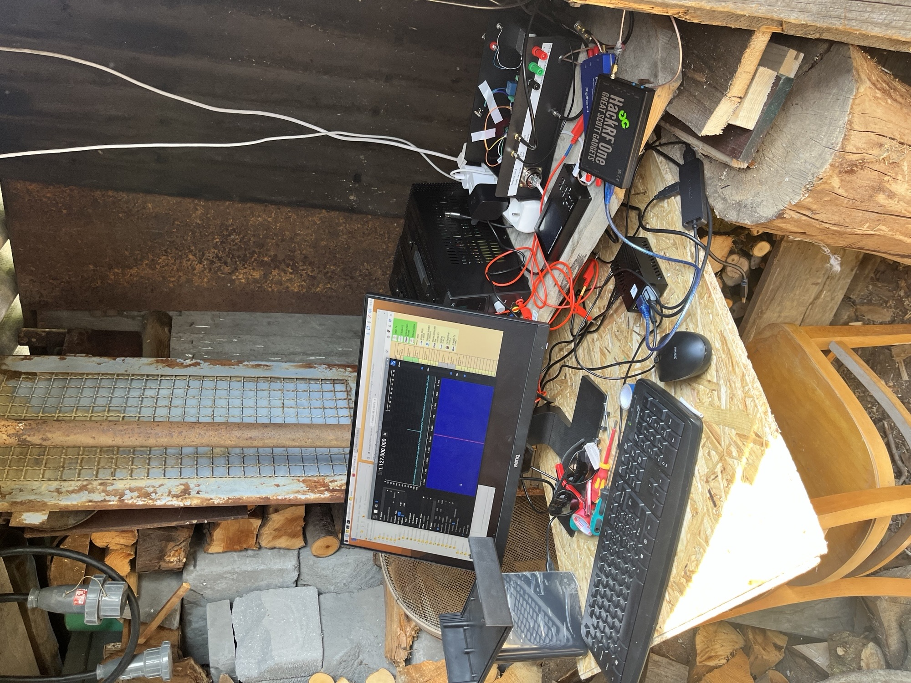
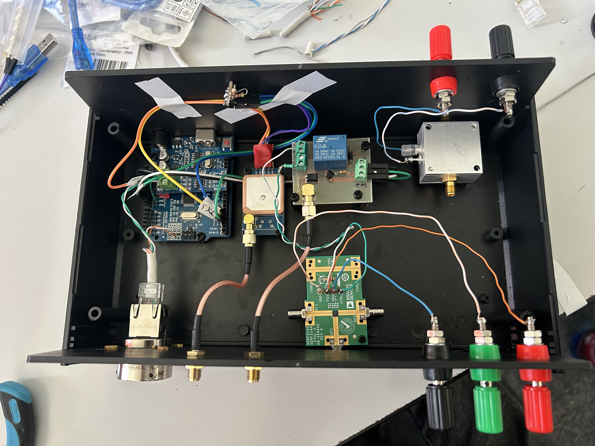
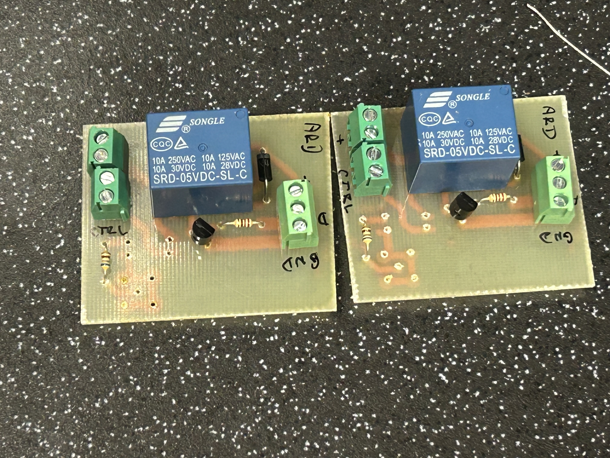
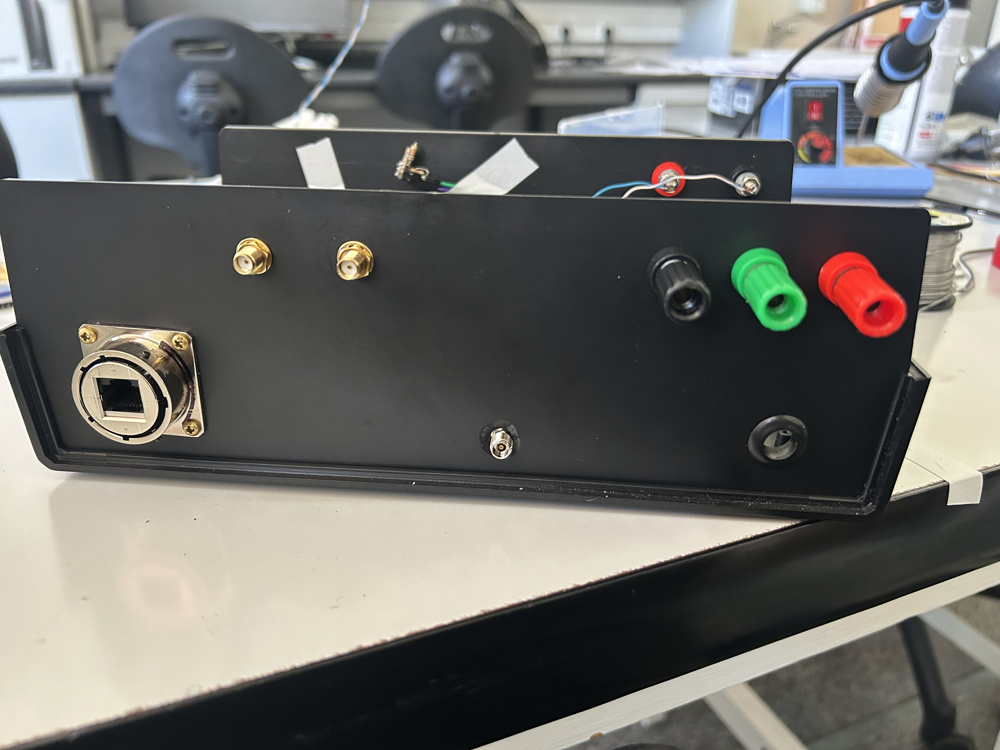
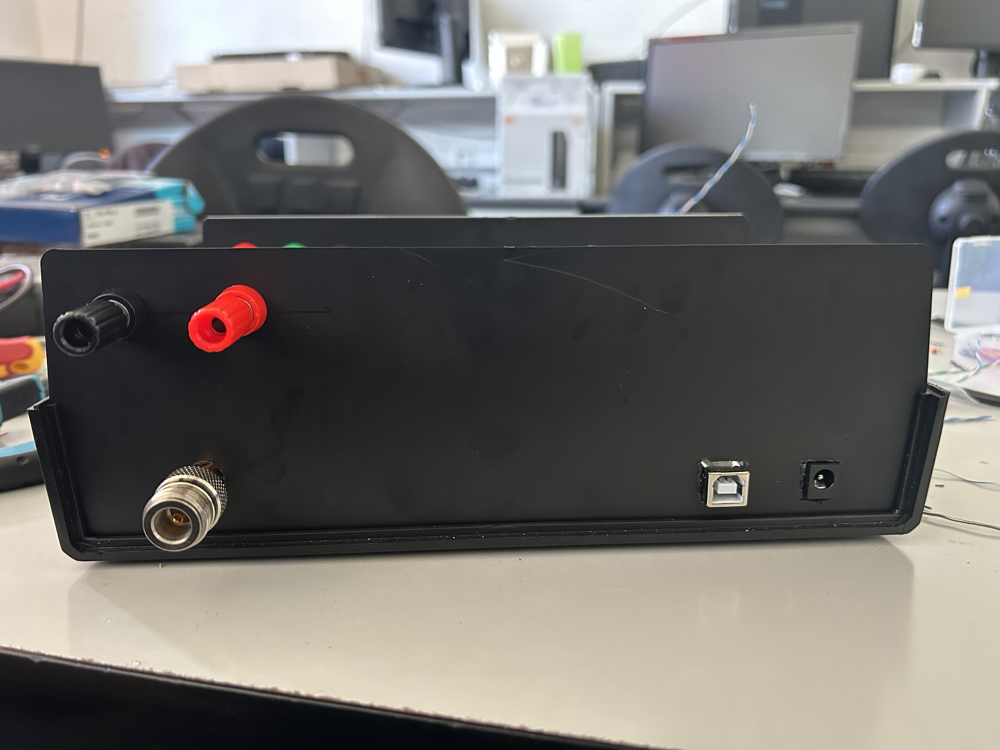
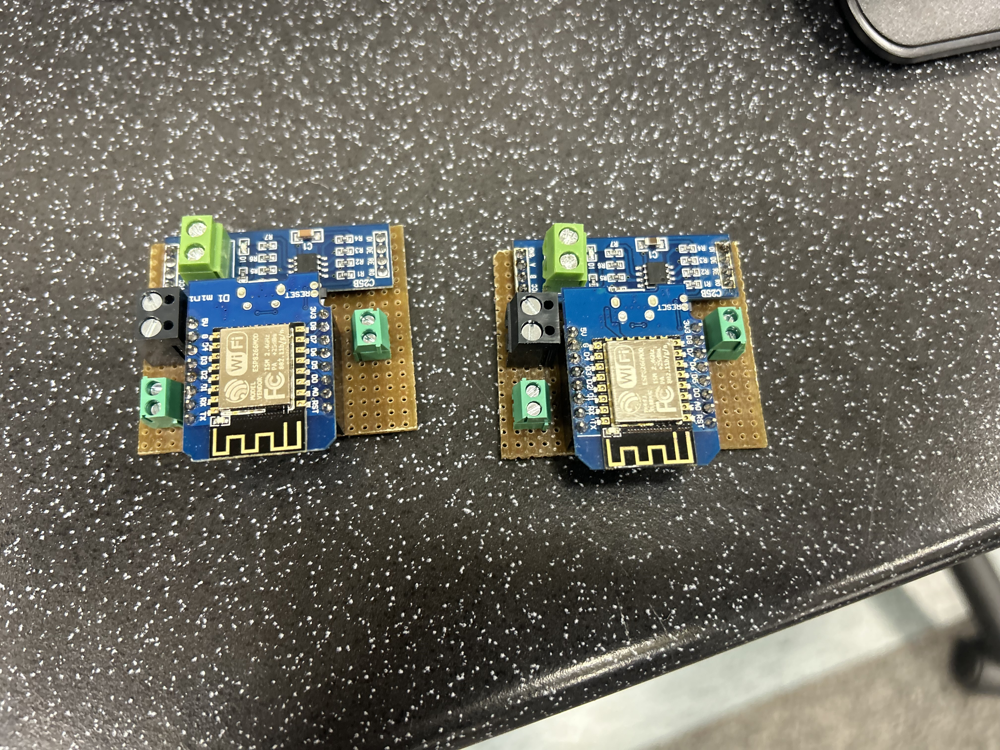

# Hardware Photographs

This gallery documents the antenna installations, equipment setups, and custom electronics developed for the measurement stations.

Some photographs show assembly and testing stages. The final hardware configuration is specified in the [component list](../component_list.csv) and [measurement methodology](../../../docs/measurement_methodology.md).

## Urban antenna installation — Zlín

*Front view of the urban antenna installation, with the faculty building and rooftop structures in the background.*

*Rear view showing the antenna support, environmental sensor radiation shield, outdoor enclosure, and cable routing.*

*Side view of the reflector, LNB assembly, and ballasted antenna support.*

## Rural antenna installation — Hošťálková

*Installation work on the rural antenna, with nearby rooftops and wooded slopes in the background.*

## Rural site context — map imagery

*Map-service imagery showing the shelter used for the antenna installation, marked by an arrow.*

*Approximate view towards the reception direction. This image provides landscape context rather than an exact view from the antenna position.*

## Equipment setups

*Equipment arrangement at the urban site during station setup, including power supplies, receiving equipment, storage, and the local computer interface.*

*Equipment arrangement at the rural site during setup and testing. Additional test equipment visible in the photograph, including a HackRF One, is not part of the documented final FOBOS SDR acquisition chain.*

## Custom control electronics

*Internal arrangement of the control enclosure during assembly, showing microcontroller electronics, the GPS module, custom PPS control circuitry, RF switch board, bias tee, and panel connections.*

*Two custom PPS control boards during assembly. The photograph shows the relay, transistor, protection diode, resistors, and terminal blocks; component population is not yet complete.*

## Enclosure panels

*One enclosure panel during assembly, showing the external signal, telemetry, and power connections.*

*Opposite enclosure panel during assembly, showing the N-type connector, USB interface, DC connector, and power terminals.*

## Environmental monitoring electronics

*Two environmental interface assemblies based on Wemos D1 mini boards and RS-485 converter modules, with terminal connections for external wiring.*

## Related documentation

- [Hardware overview](../README.md)
- [Component list](../component_list.csv)
- [Station locations](../../../docs/station_locations.md)
- [Measurement methodology](../../../docs/measurement_methodology.md)
