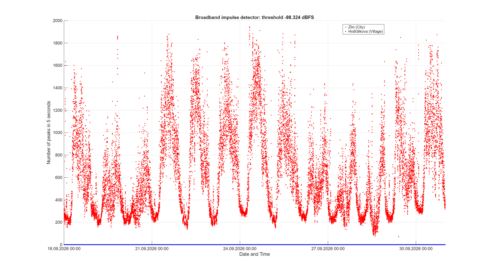
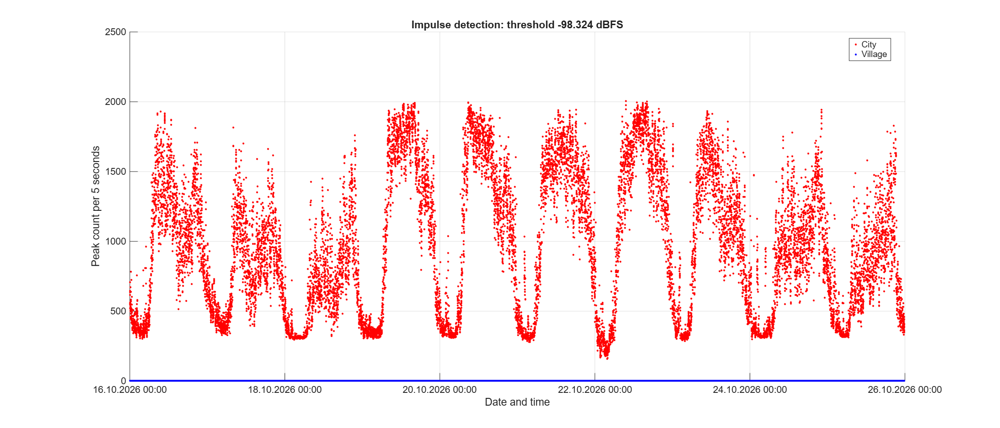

# Project evaluation

**DUAL-STATION SDR SPECTRUM MEASUREMENT**

Faculty of Applied Informatics, Tomas Bata University in Zlín, Czech Republic. Research team: Miroslav Dolejš, Anton Džima, Stanislav Kovář, and Eliška Štrajtová.

## Overall assessment

The project established and demonstrated a practical method for comparing C-band satellite downlink reception at two simultaneously operated SDR stations. Across two campaigns, the urban station in Zlín showed substantially higher broadband peak counts, greater short-term noise fluctuation, and lower daytime SNR than the rural reference in Hošťálkova. A six-day paired analysis also found a lower proportion of jointly recovered frames during working-day daytime than at night.

These findings are consistent with activity-related terrestrial interference. Together with the mapped coverage of the adjacent 3.4–3.8 GHz mobile band, they support the hypothesis that 5G transmitters contribute substantially to the urban interference. The measurements do not establish which transmitters are responsible, prove that 5G is the dominant cause, or distinguish out-of-band emissions from receiver front-end overload.

## Objectives and delivered capability

The scientific objectives were to compare urban and rural reception, characterize broadband interference over time, evaluate noise and SNR, investigate day–night differences, and reconstruct and compare frames from a selected downlink.

Two stations were built with the same principal components and acquisition settings. Each combined a 1 m reflector and C-band LNB, a FOBOS SDR, Raspberry Pi acquisition and storage, a GPS-disciplined frequency reference, injected timing markers, and temperature/humidity telemetry. Installation differences included 17 m of receiving cable at the urban site and 10 m at the rural site. These differences matter when interpreting absolute levels.

The resulting capability includes autonomous scheduled recording with remote supervision, metadata capture, manual disk exchange with SSD buffering, and a documented processing chain from RAW I/Q samples to spectral metrics and decoded-frame comparisons. This is a demonstrated dual-site measurement method; the external frequency references do not make the complete receiving chains phase-coherent.

See the [station documentation](../measurement_stations/README.md) and [measurement methodology](../docs/measurement_methodology.md) for implementation details.

## Measurement coverage

| Campaign | Dates | Recordings per station | Total RAW recordings |
| --- | --- | ---: | ---: |
| September | 18–30 September 2026 | 1,872 | 3,744 |
| October | 16–25 October 2026 | 1,440 | 2,880 |
| **Total** | **23 calendar days** | **3,312** | **6,624** |

Each recording has a matching JSON file. The combined RAW/JSON archive contains **15,887,837,575,362 bytes**, approximately **15.89 TB (14.45 TiB)**. These are logical file sizes. The [recording catalog](../data/catalog/README.md) and [archive summary](../data/catalog/archive_summary.csv) provide the counts and volume breakdown.

The stations recorded nominally 60 seconds every ten minutes at 10 MS/s, with interleaved little-endian int16 I/Q. Recording was duty-cycled, not uninterrupted full-time capture. The IF centre of 1312 MHz and LNB oscillator of 5150 MHz correspond to RF centre 3838 MHz and approximate coverage 3833–3843 MHz. The downlinks of interest were 3839 MHz and 3842 MHz.

The cataloged counts match 144 scheduled recordings per local calendar day and station. The repeated local hour during the return to standard time on 25 October was not acquired. File counts and metadata consistency do not independently prove sample continuity within every recording or the absence of SDR streaming errors. JSON times are software references; precise station alignment requires analysis of the recorded signals.

Both campaigns have spectral and environmental results and selected spectrogram/decoding examples. PPS inventory and paired frame analysis cover **25–30 September only**. The frame results must not be presented as a complete 23-day frame comparison.

## Processing and statistical conventions

The spectral analyses use an 8192-point FFT, a Kaiser window with beta 5, and 4096-sample overlap. The RF noise-reference band is 3836.5–3837.5 MHz. Broadband peak counts use eleven five-second chunks from recording offset 0 s, with a threshold of approximately −98.324 dBFS and a minimum peak separation of three STFT time steps. Noise statistics use ten five-second chunks beginning at offset 5 s.

Power values are relative to the recorder's digital scale, not calibrated RF input power in dBm. SNR integrates 1 MHz around 3839 MHz and 0.5 MHz around 3842 MHz. The first integration width is distinct from the approximately 2 MHz occupied downlink bandwidth used for frame processing. The estimator subtracts a noise estimate from total band power; it does not separately identify additional interference inside the downlink band.

The descriptive comparisons below use local time, with night defined as 01:00–05:00 and daytime as 08:00–20:00. Non-working days comprise weekends and the 28 September public holiday. September SNR medians exclude the simultaneous low-SNR episode from 26 September at 13:00 to 27 September at 07:30. Peak-rate, noise-fluctuation, and SNR summaries are medians of the relevant five-second observations unless explicitly identified as totals. They are descriptive statistics, not controlled causal estimates or formal significance tests. Full processing settings and result interpretation are in the [analysis workflow](../docs/analysis_workflow.md) and [results overview](../results/README.md).

## Principal results

### Broadband interference

| Metric | September | October |
| --- | ---: | ---: |
| Urban detected peaks, total | 13,085,305 | 15,429,207 |
| Rural detected peaks, total | 73 | 12 |
| Urban median peaks per 5 s at night | 251 | 346 |
| Urban median peaks per 5 s in working-day daytime | 1,006 | 1,557 |
| Urban median peaks per 5 s in non-working-day daytime | 448 | 904 |

Across both campaigns, the detector registered **28,514,512 urban peaks and 85 rural peaks**. Urban counts followed a recurring daily pattern and were lower on non-working days. In the selected urban spectrograms, short disturbances span the recorded window, including the downlinks.

These counts are accepted local maxima under a particular detector configuration. They are not numbers of transmitters, numbers of independent complete events, or measurements of event duration. Few or no accepted peaks do not prove an interference-free rural environment: weaker fluctuations and short downward dips remain visible in some rural examples.

A fixed recorder-referenced threshold interacts with receiver gain drift. The higher October counts therefore should not be treated as a calibrated measurement of increased terrestrial transmitter activity relative to September. The within-campaign working-day pattern persisted in the reported comparisons of days with similar air temperatures, supporting an activity-related interpretation without identifying the source.

*September broadband peak counts for the two stations. Detector configuration and digital reference are documented with the result set.*

*October broadband peak counts. Compare temporal patterns while considering threshold and receive-chain limitations.*

### Noise fluctuation and downlink SNR

| Metric | September | October |
| --- | ---: | ---: |
| Urban median noise-level standard deviation | 2.86 dB | 3.27 dB |
| Rural median noise-level standard deviation | 0.72 dB | 0.84 dB |
| Urban 3839 MHz SNR, night / daytime | 8.4 / 5.5 dB | 9.3 / 5.3 dB |
| Urban 3839 MHz SNR, working-day daytime | 4.7 dB | 3.9 dB |
| Rural 3839 MHz SNR, night / daytime | 9.2 / 9.2 dB | 10.2 / 10.1 dB |
| Urban 3842 MHz SNR, night / daytime | 8.7 / 5.6 dB | 8.7 / 5.2 dB |

The urban noise-reference fluctuation was approximately four times the rural median and increased in daytime. The urban 3839 MHz SNR fell by approximately 3–4 dB from night to daytime, while the rural value was comparatively stable. A similar urban daily pattern was present at 3842 MHz, superimposed on changes shared by both stations.

Between 26 September at 13:00 and 27 September at 07:30, the 3839 MHz SNR fell at both sites, without a comparable collapse at 3842 MHz. This supports a common influence associated with the received link rather than an urban-only disturbance; a change of the 3839 MHz transmission is a plausible explanation. The observations alone do not establish the exact mechanism. Having a second receiving station helps distinguish shared changes from site-dependent effects.

Absolute noise medians are unsuitable for a simple urban-versus-rural power comparison because the receiving chains were not calibrated end to end and the cable losses differ. The rural site also has mapped mobile coverage and weaker disturbances of unidentified origin; it is a reference site, not a zero-interference control.

Full [noise statistics](../results/noise_statistics/) and [SNR results](../results/snr/) are available for both campaigns.

### Temperature and receive-chain stability

At the rural station, the noise-reference level co-varied inversely with air temperature near the antenna. The reported Pearson correlation was **−0.82** in September and **−0.78** in October, with slopes of approximately **−0.061 dB/°C** and **−0.055 dB/°C**, respectively.

Temperature-dependent receive-chain gain is a plausible explanation, but the sensor measured air temperature rather than LNB or SDR temperature. Correlation therefore does not independently establish component gain drift as the cause. Activity-related fluctuations obscured the relationship at the urban site.

These observations motivate end-to-end calibration, component-temperature monitoring, and assessment of adaptive or recording-specific references. Estimating noise within the same recording reduces sensitivity to common gain changes, but does not establish calibrated RF power or remove every possible interference bias.

See the [temperature/noise results](../results/noise_temperature/) for separate station datasets and figures.

### Standalone frame reconstruction

| Nominal recording | Source offsets | Urban exported frames | Rural exported frames |
| --- | --- | ---: | ---: |
| 25 September 2026, 03:00 | 10–15 s | 69 | 137 |
| 20 October 2026, 03:00 | 25–30 s | 74 | 162 |

The 3839 MHz signal was demodulated and decoded into network frames passing the decoder's validation checks, with PCAP export for inspection. The physical-layer standard, modem, satellite identity, and traffic origin were not conclusively identified by this reconstruction.

These standalone examples share nominal recording times and offsets but have no additional PPS/cross-correlation alignment. Their counts are not estimates of reception loss over an exactly shared transmission interval. In the October city example, 73 valid frames came from the first half and only one from the second, compared with 82 and 80 at the rural station; the total masks substantial variation inside the short extract. Re-encoding disagreement is a decoder diagnostic, not BER. PCAP calendar timestamps are not measurement dates.

The [standalone decoding outputs](../results/downlink_frames/demodulation_pcap/) document the examples and their timing limitations. Licensing and treatment of captured communication content are separate from the assessment of original analytical results.

### PPS-assisted paired frame analysis

| Coverage or observation | Value |
| --- | ---: |
| Candidate recording pairs, 25–30 September | 864 |
| Analyzed pairs | 747 |
| Pairs skipped by joint SNR screening | 110 |
| Pairs excluded by PPS criteria | 7 |
| Analyzed seconds | 7,470 |
| Urban decoded frame occurrences | 143,803 |
| Rural decoded frame occurrences | 263,171 |
| Matched common frame occurrences | 141,026 |
| Urban-only / rural-only occurrences | 2,777 / 122,145 |
| Common / rural ratio | 53.59% |

The procedure uses recorded PPS markers for coarse alignment, then cross-correlation and stability checks to select and align decoded intervals. It analyzes the first ten confirmed stable seconds of each accepted pair. Frames are matched using byte equality and compatible timing.

The aggregate ratio is **141,026 / 263,171 = 53.59%**, the fraction of rural decoded observations also matched at the urban station in the selected intervals. It is not the ratio of all urban frames to all rural frames, a bit-error rate, or end-to-end network packet loss. Traffic that neither receiver decoded is not counted.

Reported common/rural ratios were **71–84% at night** on the five days with night-time coverage and **33–39% in working-day daytime** on the three working days with complete coverage. The per-recording ratio was associated with urban SNR (Spearman rho approximately 0.88), with little association with rural SNR (approximately 0.04). These are descriptive associations. The received traffic rate and frame mix also varied, and a controlled comparison by frame length/type was not performed.

Coverage on 26–27 September was reduced by joint SNR screening, so daily ratios rest on unevenly distributed observations. The PPS inventory identified missing rural markers in seven recordings; their physical cause was not verified. The public [global summary](../results/downlink_frames/visualization/2026-09-25_2026-09-30/global_summary.csv), [pair audit](../results/downlink_frames/long_term_analysis/2026-09-25_2026-09-30/pair_audit.csv), and [PPS inventory](../results/downlink_frames/pps_inventory/2026-09-25_2026-09-30/) provide the supporting coverage information.

*Paired frame results for 25–30 September. Ratios apply to the selected analyzed seconds, with gaps and exclusions interpreted through the audit tables.*

*Coverage separates successfully analyzed pairs from joint-SNR and PPS exclusions.*

## Assessment of the project outputs

| Objective or output | Assessment and evidence |
| --- | --- |
| Build and operate two comparable receiving stations | Demonstrated with a documented dual-station design and matching acquisition settings; installation differences remain documented. |
| Characterize temporal broadband interference | Delivered for both campaigns, with counts and selected marked spectrograms; the detector does not identify transmitters. |
| Evaluate noise, SNR, and temperature relationships | Delivered for both campaigns, subject to uncalibrated receive-chain and estimator limitations. |
| Reconstruct and compare downlink frames | Demonstrated with standalone examples from both campaigns and synchronized paired analysis of the six-day September subset. |
| Make methods and analytical products reusable | Hardware documentation, acquisition/firmware source, analysis code, result files, catalogs, and short examples are publicly organized in the repository. Full-archive access is handled separately. |
| Establish broader coexistence conclusions | The two-site, two-campaign comparison provides evidence for a local activity-related interference problem, but does not establish a general causal result for all 5G deployments or C-band receivers. |

## Limitations and further technical work

The principal limitations are the two-site observational design, uncalibrated absolute levels, unequal cable runs, fixed detection thresholds, air-temperature telemetry rather than component-temperature measurements, and the limited frame-analysis subset. Neither mapped network coverage nor a daily activity pattern identifies a specific interfering transmitter. The exact satellite and coupling mechanism remain unresolved.

Useful technical extensions include end-to-end receive-chain calibration, matched cable arrangements, LNB temperature monitoring, improved marker-controller GPS reception, and processing acceleration to extend paired decoding. The same published workflow can be applied to further days when the matching RAW recordings, PPS inventory, and SNR inputs are available. These are opportunities for further work, not commitments to additional deliverables.

To investigate the 5G hypothesis directly, follow-up measurements could compare reception with and without an appropriate pre-LNB rejection filter and examine pulse timing against independently measured terrestrial transmissions. Timing resemblance alone would not establish 5G attribution; filter insertion loss and changes to the receiving chain must also be accounted for. Longer campaigns, additional locations, seasons, and frequency windows would test how well the observed patterns generalize.

## Published outputs and use

The project provides a reusable basis for satellite–terrestrial coexistence studies, distributed spectrum monitoring, and teaching. The strongest demonstrated output is the combined method: simultaneous reference measurements, documented timing alignment, multiple reception metrics, and explicit processing coverage.

Use the [repository documentation](../docs/README.md), [station implementation](../measurement_stations/README.md), [analysis scripts](../analysis/README.md), [result overview](../results/README.md), and [recorded dataset description](../data/README.md) as the entry points. The full-archive access status is maintained in [data_access.md](../data/data_access.md); this assessment does not promise public availability of the complete RAW archive.

Original report text follows the CC-BY-4.0 scope described in [LICENSING.md](../LICENSING.md). Software follows its separate Apache-2.0 allocation, and captured communication content and third-party materials remain subject to the stated exclusions.
