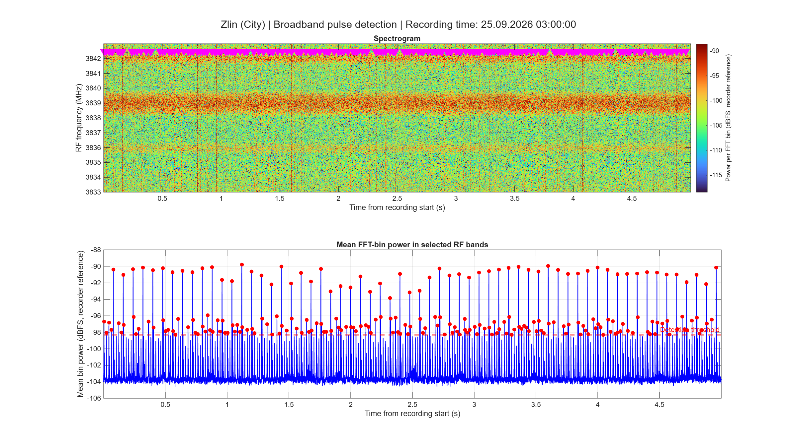
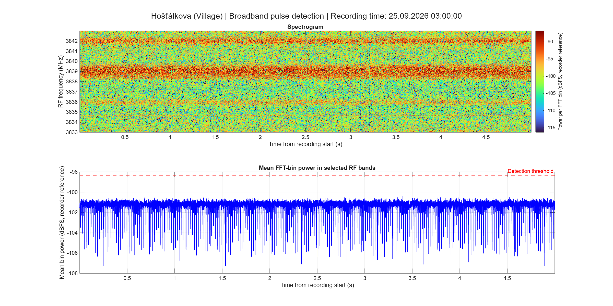
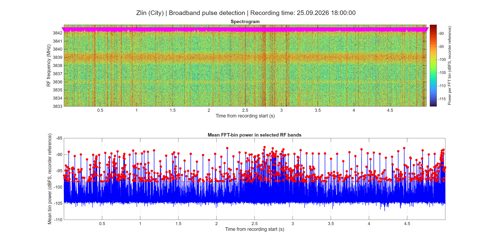
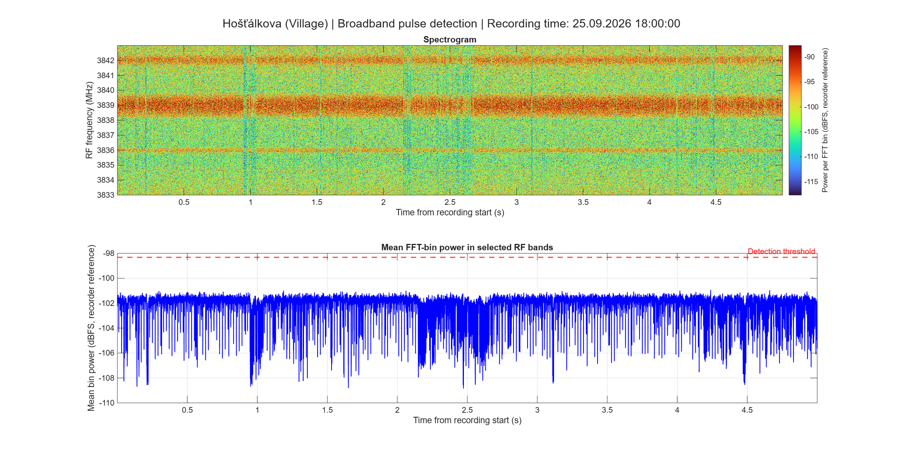

# Broadband peak detection examples: 25 September 2026

These four PNG figures show broadband peak inspection at the city station in Zlín and the village station in Hošťálkova. They belong to the September result set and show the first five seconds of the selected recordings.

| Station | Nominal recording time | Figure |
| --- | --- | --- |
| City | 25 September 2026, 03:00:00 | [Morning example](city_broadband_mark_250926_030000_morning.png) |
| Village | 25 September 2026, 03:00:00 | [Morning example](village_broadband_mark_250926_030000_morning.png) |
| City | 25 September 2026, 18:00:00 | [Evening example](city_broadband_mark_250926_180000_evening.png) |
| Village | 25 September 2026, 18:00:00 | [Evening example](village_broadband_mark_250926_180000_evening.png) |

The morning and evening selections represent expected lower and higher human activity, respectively. They are not independent measurements of terrestrial network load. Times follow the RAW filenames without timezone conversion. Corresponding station figures share a nominal recording time, but no additional PPS or cross-correlation alignment is applied in this inspection workflow.

## Reading the figures

The upper panel is the RF spectrogram. Magenta downward triangles mark detected peak times at a fixed display frequency; their vertical positions do not identify the frequency of an interfering transmitter. The lower panel shows mean FFT-bin power in the selected RF reference band, the detection threshold, and red markers at accepted local maxima.

The processing script uses the RF reference band 3836.5–3837.5 MHz. Peak detection is based on the mean power across the selected bins, expressed in recorder-referenced dBFS, with a minimum separation specified in STFT time steps. This is a threshold-based peak detector, rather than direct identification of individual transmitters or a measurement of the complete duration of broadband events.

No marked detections means that no local maxima met the configured criteria in the shown interval. It does not prove the absence of interference. The plots use their own displayed axis limits; check the numerical scales before comparing visual amplitudes.

Processing script: [detect_broadband_peaks_dbfs.m](../../../analysis/broadband_bursts/detect_broadband_peaks_dbfs.m).

These selected examples complement the [long-term broadband peak counts](../../broadband_peaks/2026-09-18_2026-09-30/). They do not replace the long-term dataset.

## Figures

### Morning: 03:00

### Evening: 18:00

