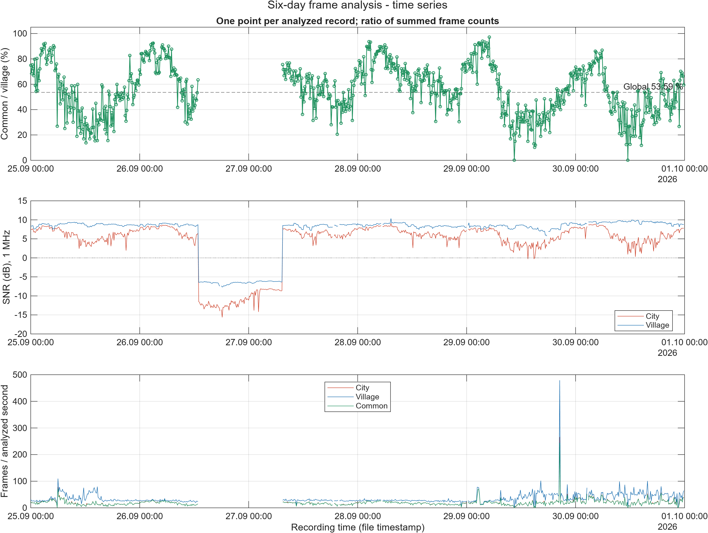
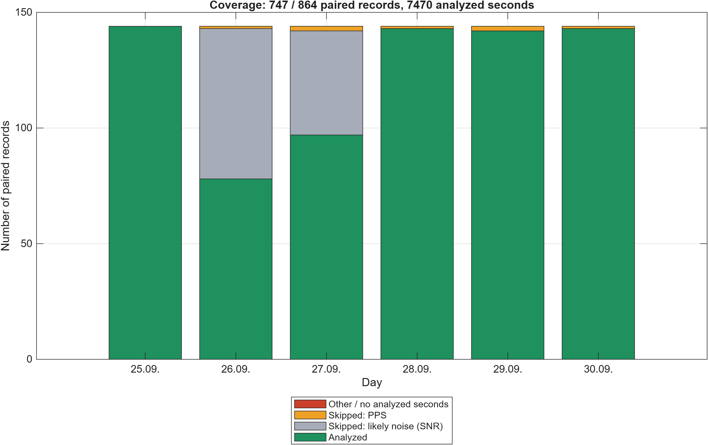

# Frame-analysis figures: 25–30 September 2026

These figures and summary tables describe the [paired frame-analysis results](../../long_term_analysis/2026-09-25_2026-09-30) from the same six-day interval.

| Figure stem | Contents |
| --- | --- |
| `01_time_series` | Recording-level common/village agreement, station SNR, and frame counts per analyzed second |
| `02_daily_summary` | Daily aggregate agreement and frame rates within the selected seconds |
| `03_snr_relationship` | Agreement versus city and village SNR, colored by day |
| `04_coverage` | Analyzed pairs and SNR/PPS exclusions by day |
| `05_within_record_variability` | Variability across selected per-second agreement ratios |

Each figure is available as PNG, vector PDF, and editable MATLAB FIG. CSV files provide recording, daily, and global summaries; `graph_summary.mat` retains the summary structure.

The aggregate ratio uses summed counts. Within-record standard deviation is expressed in percentage points, excludes undefined zero-village-frame ratios, and describes only the selected analyzed seconds. SNR refers to the 1 MHz integration band; frame synchronization uses a 2 MHz channel. Coverage is relative to the audit's candidate pairs, rather than all possible campaign acquisitions. Associations shown in the plots do not independently identify an interference source.

Processing: [plot_frame_analysis_summary.m](../../../../analysis/downlink_frames/visualization/plot_frame_analysis_summary.m).

## Files

- [01_time_series.fig](01_time_series.fig)
- [01_time_series.pdf](01_time_series.pdf)
- [01_time_series.png](01_time_series.png)
- [02_daily_summary.fig](02_daily_summary.fig)
- [02_daily_summary.pdf](02_daily_summary.pdf)
- [02_daily_summary.png](02_daily_summary.png)
- [03_snr_relationship.fig](03_snr_relationship.fig)
- [03_snr_relationship.pdf](03_snr_relationship.pdf)
- [03_snr_relationship.png](03_snr_relationship.png)
- [04_coverage.fig](04_coverage.fig)
- [04_coverage.pdf](04_coverage.pdf)
- [04_coverage.png](04_coverage.png)
- [05_within_record_variability.fig](05_within_record_variability.fig)
- [05_within_record_variability.pdf](05_within_record_variability.pdf)
- [05_within_record_variability.png](05_within_record_variability.png)
- [daily_summary.csv](daily_summary.csv)
- [global_summary.csv](global_summary.csv)
- [graph_summary.mat](graph_summary.mat)
- [records_summary.csv](records_summary.csv)

