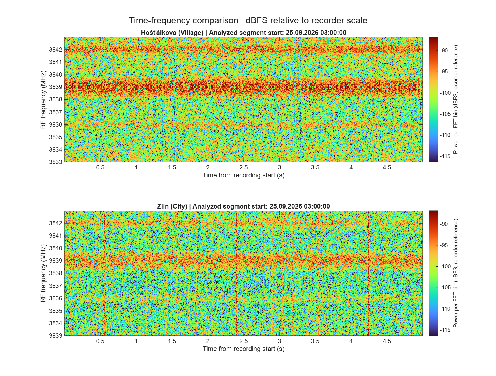
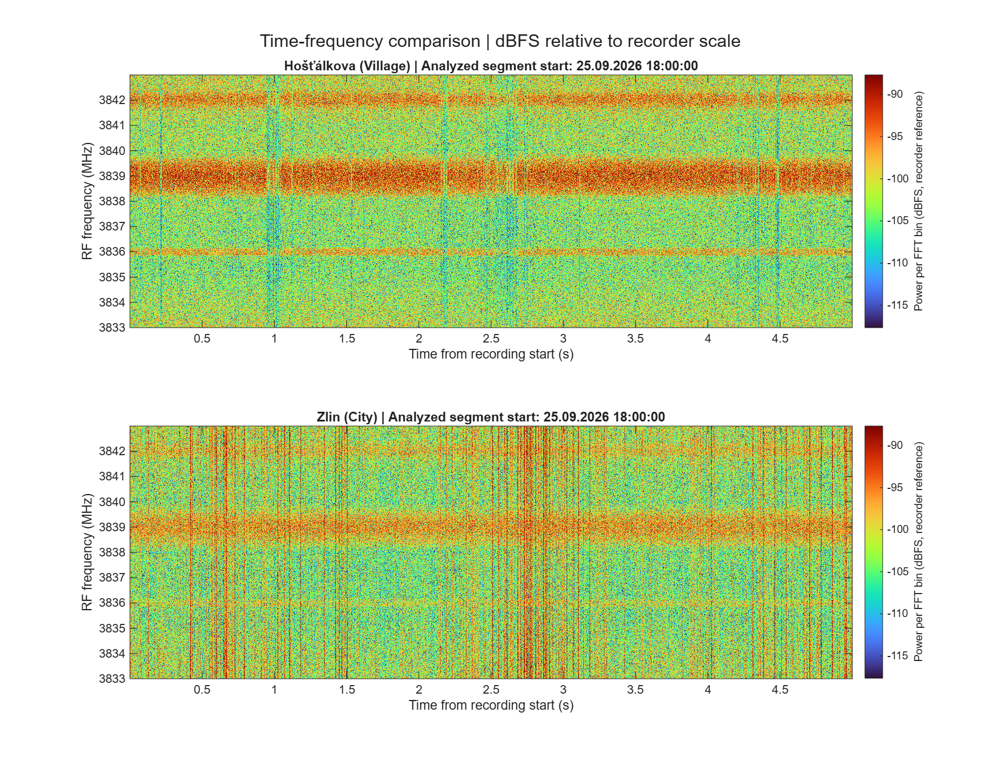

# Example spectrograms: 25 September 2026

These figures compare city and village recordings at two selected nominal recording times.

| Figure | Nominal filename time | Selection context |
| --- | --- | --- |
| [Morning example](spectrogram_250926_030000_morning.png) | 25 September 2026, 03:00:00 | Expected lower human activity |
| [Evening example](spectrogram_250926_180000_evening.png) | 25 September 2026, 18:00:00 | Expected higher human activity |

The morning/evening labels describe the selected examples. They are not independent measurements of terrestrial traffic load or evidence identifying a transmitter. Times follow the recording filenames without timezone conversion.

The comparison script uses recording-relative time axes and a shared color scale. These examples do not apply additional PPS or cross-correlation alignment between stations. See [compare_spectrograms_dbfs.m](../../../analysis/spectrogram_comparison/compare_spectrograms_dbfs.m) for the processing method.

